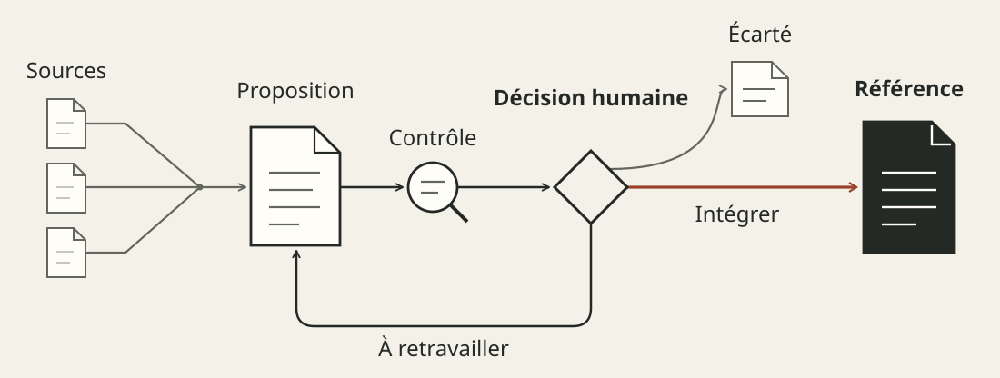

# Textility

**A human–agent collaboration framework for knowledge workers.**

**Cadrer → explorer → arbitrer → capitaliser → réviser.**

## Garder le fil au-delà de la conversation

Une analyse se poursuit sur plusieurs sessions. Les synthèses s’accumulent, mais quelle source fait foi ? Qu’a-t-on décidé ? Qu’est-ce qui reste une hypothèse ? Que faut-il relire avant d’agir ?

Textility propose un cadre de collaboration humain–agent conçu pour Hermes : sources identifiées, mandat explicite, propositions contrôlées, arbitrages attribués et acquis réutilisables. Une proposition n’est pas une décision ; un résumé n’est pas une source de vérité ; une approbation ne se transmet pas à la version suivante.

Il s’adresse aux personnes qui travaillent déjà avec un agent sur des sujets suivis dans le temps : analyse, recherche, conseil, conduite de projets et autres activités fondées sur des sources et du jugement.

Le kit peut être lu en Markdown, sans Hermes ni exécution de code.



## Une boucle, pas une chaîne de formulaires

| Étape | Question de travail |
|---|---|
| **Cadrer** | Quelle question traite-t-on, pour quel usage, avec quel mandat et quelles limites ? |
| **Explorer** | Que disent les sources, quelles interprétations tiennent et quelles options préparer ? |
| **Arbitrer** | Que retient-on, que refuse-t-on et qu’est-ce qui reste ouvert ? Qui tranche ? |
| **Capitaliser** | Quels acquis méritent de devenir des références, méthodes ou outils réutilisables ? |
| **Réviser** | Que faut-il actualiser avec les nouvelles sources, décisions et expériences ? |

Capitaliser n’est pas stocker toute la conversation. C’est sélectionner et intégrer ce qui servira à nouveau, avec ses sources et sa portée. Chaque étape n’exige ni nouveau document ni validation formelle systématique.

Les cinq verbes ne correspondent **pas à cinq skills** : l’arbitrage reste humain ; la curation contribue à l’exploration et à la capitalisation ; la reprise est transversale. Les procédures ne donnent aucun droit supplémentaire à l’agent.

## Ce qui est inclus

- **Des guides** : responsabilités, autorité, conventions, workflows, adoption, maintenance et sécurité.
- **Six modèles** : contrat d’intervention, proposition, décision, référence, reprise et trace.
- **Quatre skills** : cadrer un échange, curer un document, reprendre un contexte, réviser une référence.
- **Un exemple fictif** : scénario de prêt de matériel et mini-vault Obsidian autonome.
- **Des contrôles Python** : vérificateur statique en lecture seule et tests, sans dépendance externe.

Aucun serveur, gestionnaire de tâches, plugin communautaire, compte connecté ou export de profil n’est imposé. Le kit ne contient aucune donnée professionnelle réelle ; les événements et validations du démonstrateur sont fictifs, pas des résultats de test d’agent.

## Commencer en lecture seule

1. Lire les [principes et responsabilités](docs/01-principes.md), puis le [scénario fictif](examples/SCENARIO.md).
2. Copier **uniquement** [examples/vault/](examples/vault/) dans un dossier de démonstration indépendant. Ne pas utiliser le vault de travail comme terrain d’essai.
3. Lire `Accueil.md` dans cette copie. Pour un essai Obsidian, ouvrir la copie seule ; aucun plugin communautaire n’est requis.
4. Demander explicitement à l’agent de lire le contrat `AGENTS.md` de la copie, sans supposer son chargement automatique, puis lui demander :

> À partir de ce mini-vault, explique la règle de prêt qui fait référence. Distingue les propositions refusées et la question ouverte. Ne modifie aucun fichier.

5. Vérifier qu’il cite la décision ou la référence : registre commun, pas de copie personnelle officielle, durée de conservation non décidée. Le cache ne suffit pas comme preuve autonome.

Les approbations fictives ne doivent jamais être reprises dans un document réel. Pour aller plus loin, suivre le [guide d’adoption](docs/04-adoption.md) et tester les révisions sur copies.

**Ne pas écraser `SOUL.md`, `AGENTS.md`, la mémoire ou les conventions de l’utilisateur.** Adapter le kit à l’existant, pas l’inverse. Une convention documentaire ne remplace ni les permissions techniques ni l’autorisation de publication.

## Parcours de lecture

| Pour… | Lire |
|---|---|
| Comprendre qui produit, contrôle et décide | [Principes](docs/01-principes.md) |
| Distinguer sources, propositions, références et caches | [Conventions](docs/02-conventions.md) |
| Conduire la curation, la reprise et la révision | [Workflows](docs/03-workflows.md) |
| Essayer le kit et adapter son environnement | [Adoption](docs/04-adoption.md) |
| Entretenir les documents et préparer un partage | [Maintenance et sécurité](docs/05-maintenance-securite.md) |
| Préparer ses propres documents | [Modèles](templates/README.md) |
| Examiner les procédures proposées à l’agent | [Skills](skills/README.md) |
| Suivre un exemple, y compris le refus et l’inconnue | [Scénario](examples/SCENARIO.md) |
| Comprendre la filiation et les limites | [Provenance](docs/06-provenance.md) |

## Contrôler une copie

Depuis la racine du dépôt, avec **Python 3.10+** et sa bibliothèque standard :

```sh
python scripts/check_pack.py .
python -m unittest discover -s scripts -p "test_*.py" -v
```

Si Python s’appelle `python3` sur votre système, utiliser ce nom. Le vérificateur ne corrige rien et n’approuve aucun contenu. Les tests utilisent des répertoires temporaires. Consulter la [notice des contrôles](scripts/README.md) pour leur portée exacte.

**Tests statiques ≠ comportement de l’agent.** Le vérificateur et les sept tests de non-régression ont été exécutés sur cette préparation locale. Le chargement natif des skills, la recette Obsidian et les essais comportementaux restent à vérifier dans l’environnement destinataire.

## Origine et réutilisation

Le nom Textility s’inspire du concept de *textility* chez Tim Ingold ; voir la [provenance](docs/06-provenance.md).

La [licence MIT](LICENSE) du kit d’origine est conservée. Voir la [politique de sécurité](SECURITY.md) et l’[historique](CHANGELOG.md).
